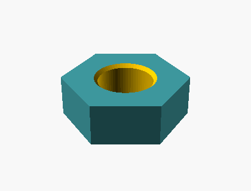
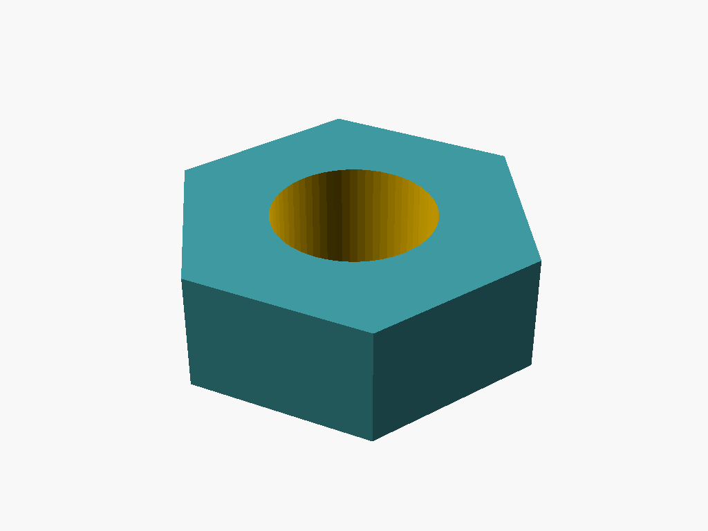
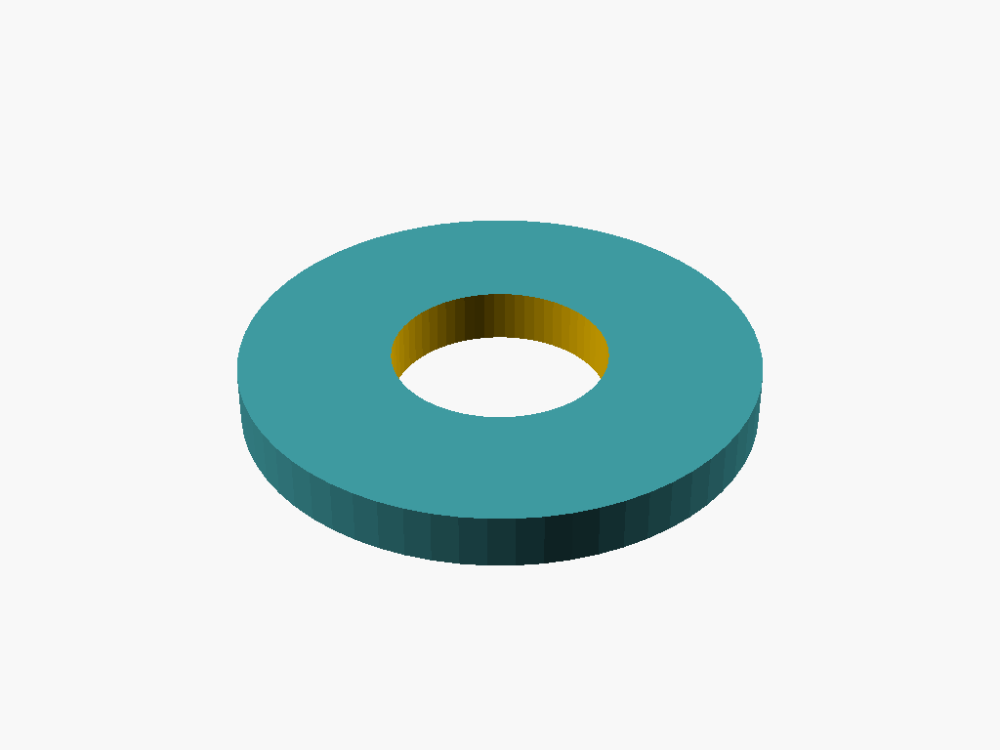
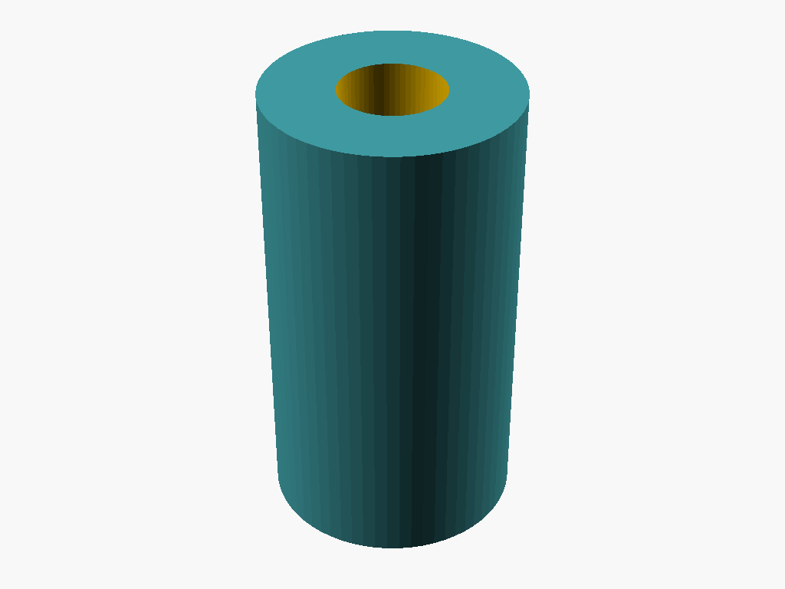
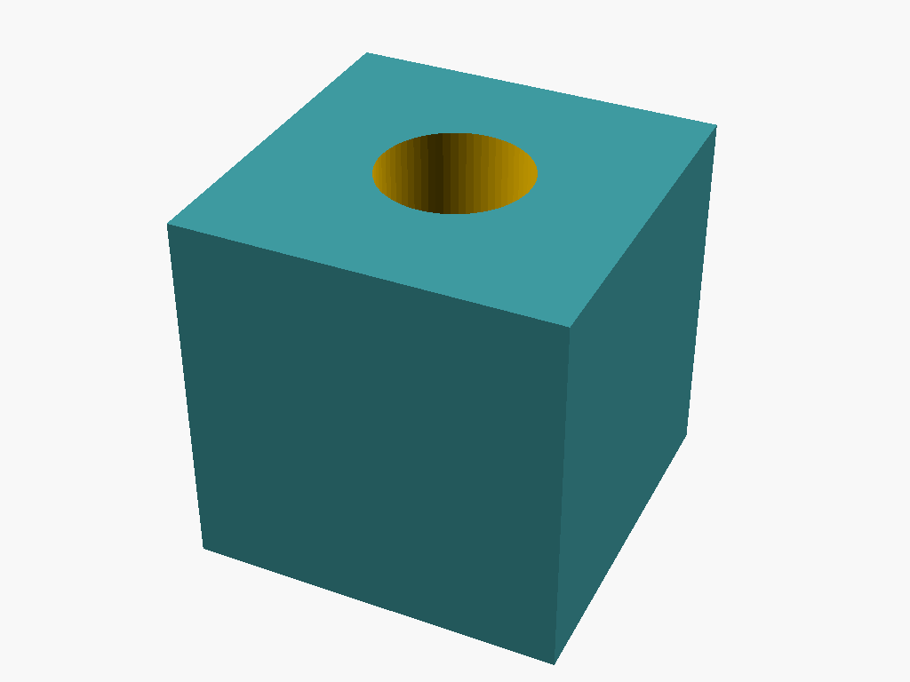
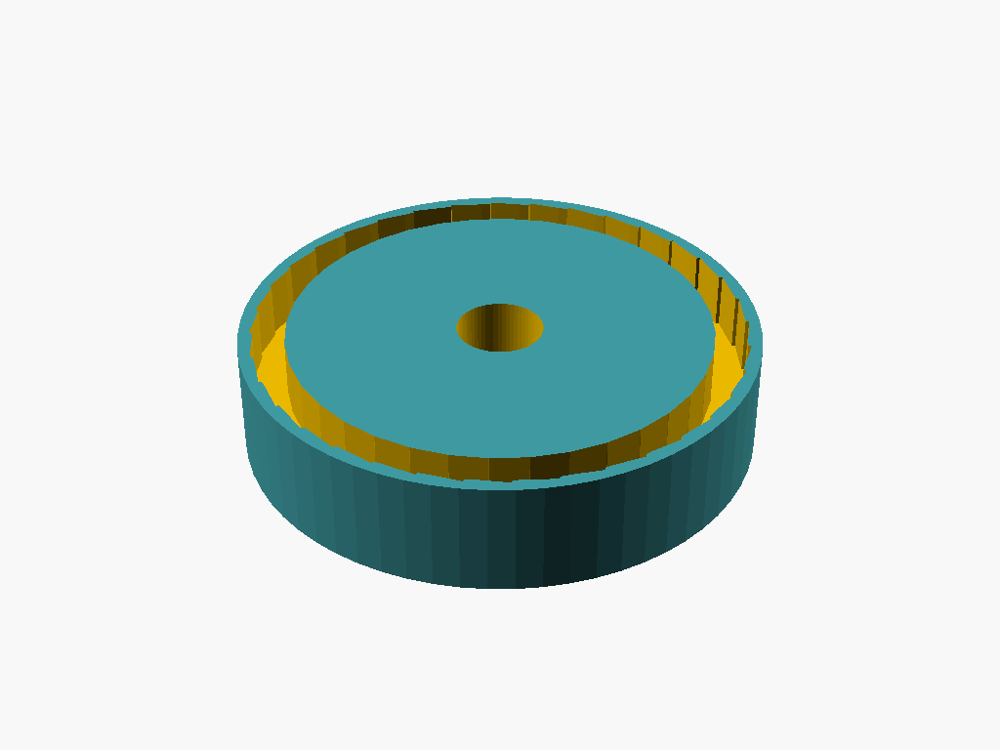
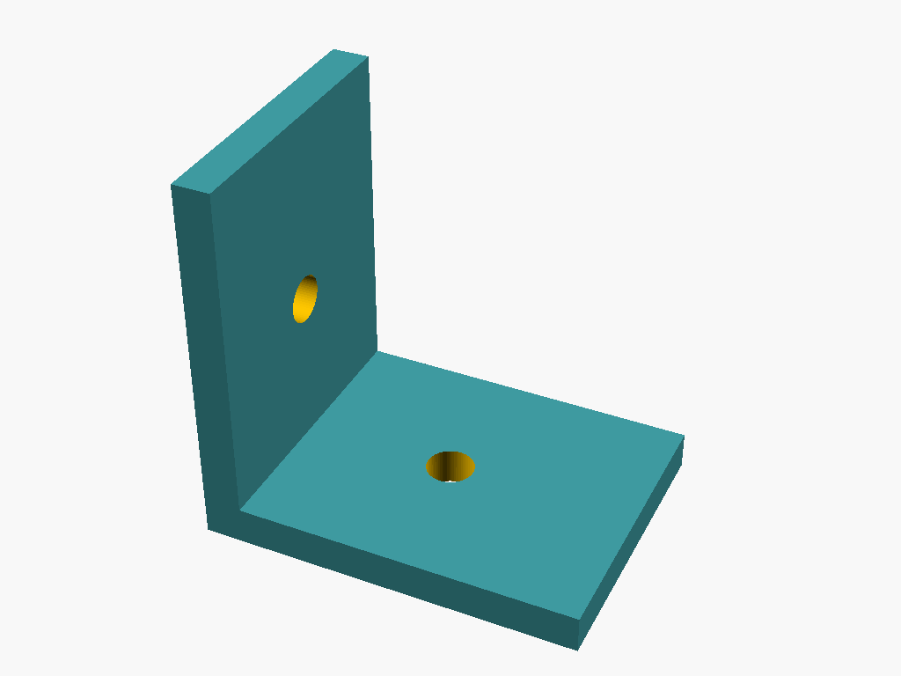

# textcad

Describe a part in plain English and get a printable STL. A model writes OpenSCAD code, and each attempt is checked by compiling it, exporting it, and (optionally) showing renders to a local vision model. Failures go back to the model until the part passes or the attempts run out.

[](https://github.com/dbhavery/textcad/actions/workflows/ci.yml)
[](LICENSE)
[](pyproject.toml)

<p align="center">
  
</p>

## The problem

Making a simple printable part, such as a washer, a nut or a bracket, means learning a CAD program first. Asking a language model to write CAD code instead often gives code that does not compile, does not export to a printable file, or exports the wrong shape.

## How it solves it

You type a description of the part. textcad runs a loop:

1. A model writes parametric OpenSCAD code for the request.
2. **Compile check:** OpenSCAD must render a preview, and if it cannot, the compiler error goes back to the model.
3. **Export check:** OpenSCAD must export a non-empty STL, which catches code that previews but will not export (such as mixed 2D and 3D geometry), and the failure goes back to the model.
4. **Vision check** (optional, `--inspect`): a local vision model looks at top, front and right-side renders (combined into one labeled contact sheet when Pillow is installed, otherwise sent as separate images) and approves or rejects the shape against the request. A rejection and its reason go back to the model. The vision model judges shape and named features and does not check sizes.

The loop stops at the first attempt that passes every check that ran, or after `--iters` attempts.

**If the vision model errors** (it is not running, or it returns a reply with no true/false verdict), the vision check is reported as **not run**, never as passed. The part is then accepted on the compile and export checks only, and the result says so: the CLI prints `vision_check: not run` with a note, and the library result has `"vision_check": "not run"`.

The vision check reviews an orthographic contact sheet like this one:


Example parts in `examples/`:

| Hex nut | Washer | Standoff | Cube + bore | Pulley | L-bracket |
|:---:|:---:|:---:|:---:|:---:|:---:|
|  |  |  |  |  |  |

## Who it helps

- People with 3D printers who need simple functional parts and do not use CAD.
- People who want CAD help without sending their designs to a cloud service (use the default local backend).
- Developers testing local models on a task where every answer can be checked by a program.

## Technical details

### What runs locally and what does not

| Part | Backend | Runs where | Needs |
|---|---|---|---|
| Code generation | `--backend ollama` (default) | Your machine, through Ollama at `http://localhost:11434` | Ollama and a code model, default `qwen2.5-coder:32b` |
| Code generation | `--backend claude` | Anthropic's service, through the Claude Code CLI (`claude -p`) | The `claude` CLI installed and logged in to a Claude subscription. textcad reads no API key, and your part description is sent to Anthropic. |
| Code generation | `--backend codex` | OpenAI's service, through the Codex CLI (`codex exec`) | The `codex` CLI installed and logged in. textcad reads no API key, and your part description is sent to OpenAI. |
| Vision check | `--inspect` | Your machine, through Ollama | A local vision model, default `qwen2.5vl:7b`, and Pillow for the contact sheet |
| Render and export | always | Your machine | An OpenSCAD binary |

With the default backend nothing leaves your machine. The `claude` and `codex` backends are opt-in and run their CLI from an empty temporary folder so the CLI does not read the current project's files.

### Stack

Python 3.10+ with only the standard library at runtime; Pillow is optional (it builds the contact sheets for the vision check), and OpenSCAD is called as an external program.

```
textcad/
  llm.py        minimal Ollama client (text and vision, several images per call)
  backends.py   code-generation backends: ollama, claude, codex
  codegen.py    system prompt and OpenSCAD code generation
  render.py     OpenSCAD calls: iso and orthographic views, STL export, contact sheet
  inspector.py  local vision-model check
  loop.py       the loop and its three checks
  cli.py        the `textcad` command
scripts/bench.py  runs a fixed set of parts for one code model
tests/            tests with the models and OpenSCAD replaced by stand-ins
```

### Install

```bash
git clone https://github.com/dbhavery/textcad
cd textcad
pip install -e .            # or: pip install -e ".[inspect]" for the vision check

# prerequisites
#  1. Ollama running locally with a code model:   ollama pull qwen2.5-coder:32b
#  2. (optional, for --inspect) a vision model:    ollama pull qwen2.5vl:7b
#  3. an OpenSCAD binary on PATH, or set $TEXTCAD_OPENSCAD,
#     or put a portable build under tools/openscad-*/
```

### Usage

```bash
# compile and export checks only: accepts the first part that compiles and exports
textcad "a flat washer, 24mm outer, 10mm hole, 2.5mm thick"

# add the local vision check
textcad "a hexagonal nut, 16mm across flats, 6mm thick, 8mm center hole" \
    --inspect qwen2.5vl:7b --iters 4

# use a cloud model for code generation (see the table above)
textcad "an L-bracket, 2 perpendicular legs, a 5mm hole in each leg" --backend claude

# run the fixed part set for one code model
python scripts/bench.py qwen2.5-coder:32b
```

Outputs go to `out/` (change with `--out`): `<name>.scad`, `<name>.png` (iso view) and `<name>.stl`. With `--inspect`, also `<name>_topdown.png`, `<name>_front.png`, `<name>_rightside.png` and `<name>_sheet.png`.

### Library API

```python
from textcad import run, make_vlm_inspector

result = run(
    "a hexagonal nut, 16mm across flats, 6mm thick, 8mm center hole",
    model="qwen2.5-coder:32b",
    inspector=make_vlm_inspector("qwen2.5vl:7b"),  # omit for compile and export only
    iters=4,
)
print(result["stl"], result["attempts"], result["vision_check"])
```

`result["vision_check"]` is `"passed"`, `"not run"` (the vision model errored), or `"off"` (no inspector given). If no attempt passes, `result["stl"]` is `None` and `result["error"]` says why, and `result["history"]` lists each attempt and the feedback it produced.

The code model (`llm=`) and the vision check (`inspector=`) can both be passed in, so the loop can be tested without Ollama or OpenSCAD.

### Tests

```bash
pip install -e ".[dev]"
pytest -q
```

The tests replace Ollama, the CLIs and OpenSCAD with stand-ins. They check each repair path in the loop (compile error fed back, export failure fed back, vision rejection fed back, no convergence within the attempt limit, missing OpenSCAD), that an errored or unreadable vision reply is reported as not run and never as passed, prompt building in `codegen.py`, backend selection, and how the `claude` backend calls its CLI and reports a missing CLI or a failed run. CI runs `pytest -q` on Python 3.10, 3.11 and 3.12.

### Known limits

- The vision check judges shape and named features only. It cannot measure sizes, so dimensions are not checked by anything other than the code the model writes.
- A part accepted with `vision_check: not run` passed only the compile and export checks. Look at the renders before printing it.

## License and provenance

MIT license, in [LICENSE](LICENSE). textcad contains no third-party source. The OpenSCAD binary is called as an external program and is not bundled.
